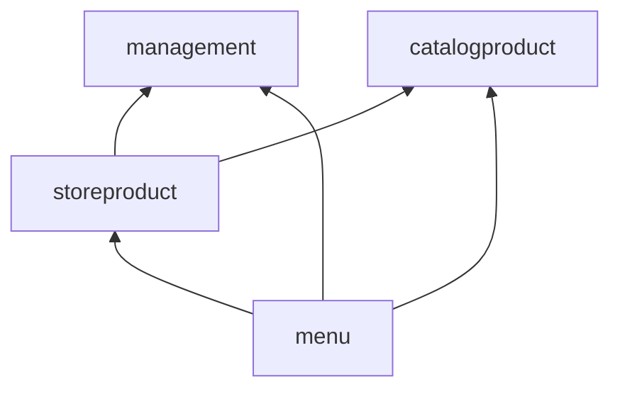

# 패키지 구조 (모듈 우선 헥사고날)

> 아키텍처 개요는 [README](README.md)를 본다. 구조의 근거는 [ADR-0005](../adr/0005-module-first-hexagonal-architecture.md)에 있다.

base package: `com.dozycoffee.store`

## 원칙

1. **최상위는 도메인 모듈이고, 모듈 안을 헥사고날로 나눈다.** 모듈 밖에는 `core`와 `common`만 둔다.
2. **의존 방향은 `adapter → application → domain`이다.** domain은 순수 Kotlin이고 Spring·Exposed·Kafka를 모른다.
3. **포트는 application에 둔다.** 바깥에서 부를 수 있는 기능은 `port/inbound`(UseCase), 애플리케이션이 바깥에 요구하는 기능은 `port/outbound`(Repository, 외부 서비스, 조회 포트)다.
4. **다른 모듈은 그 모듈의 `port/inbound`로만 쓴다.** 예외(공통 타입, 내보낸 도메인 이벤트, 노출 현황 집계 쿼리)는 ADR-0005에 있다.
5. **컨트롤러·메시지 컨슈머·스케줄러는 모두 `adapter/inbound`에서 같은 UseCase를 부른다.** 트리거가 달라도 규칙은 한곳에 있다.

## 모듈

| 모듈 | 담는 것 | 애그리거트·정책 | 요구사항 |
|---|---|---|---|
| `management` | 매장, 매장 매니저 지정, 요청 인가, 판매 범위 대상 매장 확인 | `Store`, `StoreManagerAssignment` | 1장, 2장, 7.2 |
| `catalogproduct` | Catalog 상품 복제본, Catalog 이벤트 반영, 판매 가능 여부 확인, Catalog 표시 정보 조회와 캐시 | `CatalogProduct` | 7.1 |
| `storeproduct` | 매장별 진열 설정, 수동 품절, 노출 판단, 판매 범위 정리, 매니저 화면, 노출 현황 집계 | `StoreDisplaySetting`, `StoreProductAvailability`, `ProductVisibilityPolicy`, `StoreScopeCleanupPolicy`, `ExposureSummaryPolicy` (2단계: `PendingInventoryEvent`) | 3장, 4장, 5.1, 6장 (2단계: 8장) |
| `menu` | 손님용 매장 정보와 메뉴 (조회 전용) | `CustomerStoreView` | 1.4(손님), 5.2 |

- 노출 현황은 매장별 노출 판단을 세는 일이라 노출 판단을 가진 `storeproduct`에 둔다. 따로 모듈로 두면 노출 판단 정책을 다른 모듈에 내보내야 한다.
- `menu`는 쓰기가 없어 domain이 작다(`CustomerStoreView` 같은 표현 타입만).

### 모듈 간 의존



| 모듈 | 부르는 다른 모듈의 UseCase |
|---|---|
| `management` | 없음 |
| `catalogproduct` | 없음 |
| `storeproduct` | `management`: 매장 접근 확인(인가 + 매장 상태). `catalogproduct`: 판매 가능 여부 확인(잠금 포함), 이 매장의 판매 가능 상품 목록, 표시 정보 조회 |
| `menu` | `management`: 손님용 매장 조회. `storeproduct`: 이 매장의 노출 상품 목록. `catalogproduct`: 표시 정보 조회(캐시), 유효 옵션 구성 |

- `catalogproduct`가 복제본을 바꾸면 `CatalogProductScopeChanged`·`CatalogProductDeleted`(2단계: `CatalogProductReplicated`)를 발행하고, `storeproduct`의 핸들러가 같은 트랜잭션에서 판매 범위 정리와 삭제 정리를 한다. `catalogproduct`는 `storeproduct`를 모른다.
- 순환은 만들지 않는다.

### 모듈별 주요 UseCase (제안)

UseCase는 동작마다 인터페이스 하나다. 구현은 `application/service`의 `XxxService`가 같은 모듈의 UseCase 여러 개를 구현한다.

| 모듈 | UseCase | 호출자 |
|---|---|---|
| `management` | `RegisterStoreUseCase`, `UpdateStoreUseCase`, `ChangeStoreStatusUseCase`, `GetStoreUseCase`, `SearchStoresUseCase` | 본사 API |
| | `AssignStoreManagerUseCase`, `UnassignStoreManagerUseCase`, `GetStoreManagersUseCase`, `FindManagedStoresUseCase` | 본사 API, `/me/stores` |
| | `CheckStoreAccessUseCase` (요청자가 이 매장을 읽기·쓰기 할 수 있는지, 매장 상태와 함께 돌려줌. 아니면 `STORE_NOT_FOUND`) | `storeproduct`, 매니저 API |
| | `CheckStoreAssignabilityUseCase` | Catalog 내부 API |
| | `GetCustomerStoreUseCase`, `SearchCustomerStoresUseCase` | `menu` |
| `catalogproduct` | `ApplyCatalogProductSnapshotUseCase`, `MarkCatalogProductDeletedUseCase`, `SyncCatalogProductsUseCase` | 메시지 컨슈머, 운영 작업 |
| | `CheckProductSellableUseCase` (이 매장에서 이 상품을 다룰 수 있는지. 상품 행을 `FOR SHARE`로 잠금) | `storeproduct` |
| | `ListSellableProductsUseCase` (이 매장의 `ACTIVE`·판매 범위 안 상품) | `storeproduct` |
| | `GetProductDisplayInfoUseCase`, `GetCategoriesUseCase`, `GetEffectiveOptionsUseCase` (Catalog 조회 + 캐시) | `storeproduct`, `menu` |
| `storeproduct` | `ChangeVisibilityUseCase`, `ReorderDisplayUseCase`, `ChangeStockStatusUseCase`, `GetStoreProductsUseCase`, `GetStoreProductOptionsUseCase` | 매니저 API |
| | `ListVisibleProductsUseCase` (이 매장의 노출 상품과 품절 상태) | `menu` |
| | `GetExposureCountsUseCase`, `GetExposureByStoreUseCase` | 본사 API |
| `menu` | `SearchCustomerStoresUseCase`, `GetCustomerStoreUseCase`, `GetMenuUseCase`, `GetMenuProductUseCase` | 손님 API |

## 이름 규칙

| 요소 | 이름 | 예 |
|---|---|---|
| UseCase | 동작마다 인터페이스 하나 (`port/inbound`) | `ChangeVisibilityUseCase` |
| Command / Result | `port/inbound/command`, `port/inbound/result` | `ChangeVisibilityCommand`, `StoreProductResult` |
| 서비스 | `XxxService`, 같은 모듈의 UseCase 여러 개를 구현, 트랜잭션 경계 | `StoreDisplayService` |
| 정책 | `application/policy`의 I/O 없는 순수 클래스 | `ProductVisibilityPolicy` |
| 출력 포트 | `XxxRepository`, 외부 서비스는 `XxxPort` (`port/outbound`) | `StoreRepository`, `CatalogProductInfoPort` |
| 영속성 | `XxxTable`(Exposed), `ExposedXxxRepository`(출력 포트 구현) | `StoresTable`, `ExposedStoreRepository` |
| 컨트롤러 | `adapter/inbound/web`, 요청·응답 DTO는 `request/`, `response/` | `StoreProductController` |
| 메시지 컨슈머 | `adapter/inbound/messaging`, 메시지를 Command로 번역 | `CatalogProductEventConsumer` |
| 외부 서비스 어댑터 | `adapter/outbound/{대상}` | `adapter/outbound/catalog/CatalogClient` |
| 도메인 모델 | 저장 전과 후를 타입으로 나눈다. 등록할 값은 검증하는 생성자(`NewStore`), 저장된 값의 복원은 별도 팩토리 | `NewStore(...)`, `Store.reconstitute(...)` |
| 오류 | 애그리거트별 `XxxErrorCode`, 규칙별 예외 | `StoreErrorCode`, `StoreClosedException` |

## 유스케이스 작성 관례

- **Command는 도메인 타입으로 담는다.** 문자열·정수 ID를 그대로 넘기지 않고 `StoreId`, `ProductId` 같은 타입으로 바꿔 담는다. 변환은 `adapter/inbound`에서 한다.
- 필드가 둘 이상인 입력만 Command로 만든다. 식별자 하나만 받는 유스케이스(단건 조회 등)는 파라미터로 받는다.
- 서비스가 `TransactionRunner.inTransaction { … }`으로 유스케이스의 트랜잭션 경계를 연다. Repository와 다른 모듈의 UseCase는 그 안에서 호출된다. 안쪽에서 다시 열면 바깥 트랜잭션을 이어 쓴다.
- 조회가 필요한 규칙은 서비스가 확인해 도메인 메서드에 값으로 넘긴다. 판단이 여러 애그리거트를 보면 `application/policy`의 정책에 둔다.
- 대상이 없으면 애그리거트별 `XxxNotFoundException`(404)으로 거부한다.
- **여러 애그리거트를 한 트랜잭션에서 바꿀 때는 서비스가 잠금·검증·저장 순서를 정한다.** 잠그고 → 정책에 넘겨 판단하고 → 애그리거트 메서드로 바꾸고 → 저장한다. 실제로 바뀐 애그리거트만 저장한다(낙관적 잠금 대상의 `version`이 불필요하게 오르지 않게).
- **도메인 이벤트는 저장 후 꺼내 같은 트랜잭션에서 동기로 처리한다.** `common.event.DomainEventDispatcher`가 구독 모듈의 핸들러를 같은 트랜잭션·코루틴에서 실행한다. 중간 상태가 생기지 않고, 핸들러가 실패하면 원래 변경도 롤백된다. 발행 측은 구독 측을 모른다.
- 페이지 크기·`ids` 개수 상한은 `adapter/inbound/web`이 요청 오류로 먼저 거르고, application 타입은 `require`로 한 번 더 막는다.
- 버전이 필요한 요청은 `If-Match` 헤더로 받고, 단건 응답은 `ETag`를 붙인다(`common.web.VersionHeaders`).

## 외부 연동 지점

| 연동 대상 | 방향 | 포트 | 어댑터 |
|---|---|---|---|
| Catalog — 표시용 상품 정보, 카테고리 목록, 유효 옵션 구성 | outbound | `catalogproduct.application.port.outbound.CatalogProductInfoPort` | `catalogproduct.adapter.outbound.catalog.CatalogClient` (+ 캐시) |
| Catalog — 전체 상품 상태 목록 (복제본 채우기) | outbound | `catalogproduct.application.port.outbound.CatalogProductSnapshotPort` | `catalogproduct.adapter.outbound.catalog` |
| Catalog — 상품 이벤트 구독 | inbound | `catalogproduct`의 스냅샷 적용·삭제 UseCase | `catalogproduct.adapter.inbound.messaging.CatalogProductEventConsumer` |
| Catalog → Store — 판매 범위 대상 매장 확인 | inbound | `CheckStoreAssignabilityUseCase` | `management.adapter.inbound.web` (내부 API) |
| (2단계) 재고 이벤트 구독 | inbound | `storeproduct`의 재고 반영 UseCase | `storeproduct.adapter.inbound.messaging.InventoryEventConsumer` |
| Auth | (호출 없음) | — | 토큰 검증은 스타터가 한다 |

## 전체 트리 (제안)

```
com.dozycoffee.store
├── core/                          # 도메인 공통 타입 (순수 Kotlin): AggregateRoot, DomainEvent, DomainException,
│                                  #   ErrorCode, ErrorType, StoreId, ProductId, Sku 등
├── common/                        # 기술 공통 (모듈을 모름): TransactionRunner, event/(DomainEventDispatcher),
│                                  #   exposed/(ExposedConfig, AdvisoryLockNamespace, AuditColumns), paging/, security/(StoreRoles, StoreAuthorization), time/(BusinessCalendar),
│                                  #   web/(GlobalExceptionHandler, ProblemResponses, TraceIds, VersionHeaders, 요청 제한 필터)
│
├── management/
│   ├── domain/
│   │   ├── store/                 # Store, StoreCode, Address, StoreStatus + exception/
│   │   └── manager/               # StoreManagerAssignment + exception/
│   ├── application/
│   │   ├── port/inbound/          # UseCase + command/ + result/
│   │   ├── port/outbound/         # StoreRepository, StoreManagerAssignmentRepository, StoreCodeGenerator
│   │   └── service/               # StoreService, StoreManagerService, StoreAccessService, StoreAssignabilityService
│   └── adapter/
│       ├── inbound/web/           # /admin/stores/**, /admin/store-managers, /stores/{id}, /me/stores, /internal/stores/**
│       └── outbound/persistence/  # StoresTable, StoreManagersTable, ExposedStoreRepository, …, 시퀀스 기반 코드 발급
│
├── catalogproduct/
│   ├── domain/                    # CatalogProduct, StoreScope, CatalogProductStatus + event/(CatalogProductScopeChanged 등)
│   ├── application/
│   │   ├── port/inbound/          # 스냅샷 적용·삭제·동기화, 판매 가능 여부 확인, 판매 가능 상품 목록, 표시 정보 조회
│   │   ├── port/outbound/         # CatalogProductRepository, CatalogProductInfoPort, CatalogProductSnapshotPort
│   │   └── service/
│   └── adapter/
│       ├── inbound/messaging/     # CatalogProductEventConsumer (메시징 기술 결정 후)
│       └── outbound/
│           ├── persistence/       # CatalogProductsTable, CatalogProductTargetStoresTable, ExposedCatalogProductRepository
│           └── catalog/           # CatalogClient (dozySystemWebClient, 응답 번역, Caffeine 캐시)
│
├── storeproduct/
│   ├── domain/
│   │   ├── display/               # StoreDisplaySetting, StoreDisplayOrder, Visibility + exception/
│   │   ├── availability/          # StoreProductAvailability, AvailabilitySource, StockStatus + exception/
│   │   └── (pending/)             # 2단계: PendingInventoryEvent
│   ├── application/
│   │   ├── port/inbound/          # 매니저 설정 변경·조회, 노출 상품 목록, 노출 현황
│   │   ├── port/outbound/         # StoreDisplaySettingRepository, StoreProductAvailabilityRepository, ExposureQueryPort
│   │   ├── policy/                # ProductVisibilityPolicy, StoreVisibility, StoreScopeCleanupPolicy, ExposureSummaryPolicy
│   │   └── service/               # 설정 변경, 조회, catalogsync(CatalogProduct* 이벤트 핸들러)
│   └── adapter/
│       ├── inbound/web/           # /stores/{storeId}/products/**, /admin/product-exposures/**
│       ├── (inbound/messaging/)   # 2단계: InventoryEventConsumer
│       └── outbound/
│           ├── persistence/       # StoreDisplaySettingsTable, StoreProductAvailabilitiesTable, Exposed…Repository
│           └── query/             # ExposedExposureQuery (노출 현황 집계, 다른 모듈 테이블 읽기 전용)
│
└── menu/
    ├── domain/                    # CustomerStoreView
    ├── application/
    │   ├── port/inbound/          # 손님용 매장 목록·정보, 메뉴, 메뉴 상품
    │   └── service/               # 다른 모듈 UseCase를 조합
    └── adapter/inbound/web/       # /public/stores/**
```

- 테스트도 같은 트리를 따른다. 여러 모듈이 함께 쓰는 `fixture/`와 `support/`, 시나리오 테스트(`scenario/`), Konsist 테스트(`architecture/`)는 테스트 소스 최상위에 둔다.

## 아키텍처 테스트 (Konsist)

| 규칙 | 검사 |
|---|---|
| domain은 순수하다 | `..domain..`이 `org.springframework`, `org.jetbrains.exposed`, Kafka, `..application..`, `..adapter..`를 import하지 않는다 |
| 계층 방향 | `adapter → application → domain`. application은 adapter를 import하지 않는다 |
| 다른 모듈은 UseCase로만 | 모듈 A의 코드가 모듈 B를 참조하면 `B.application.port.inbound..`, `B.domain.event..`(허용된 구독자만)이어야 한다. 예외: `storeproduct.adapter.outbound.query`의 테이블 참조 |
| 모듈 의존 방향 | 위 표의 방향만 허용, 순환 없음 |
| 이름 | `XxxUseCase`는 `port/inbound`, `XxxRepository`는 `port/outbound`, `XxxController`는 `adapter/inbound/web`, `ExposedXxxRepository`는 `adapter/outbound/persistence` |
