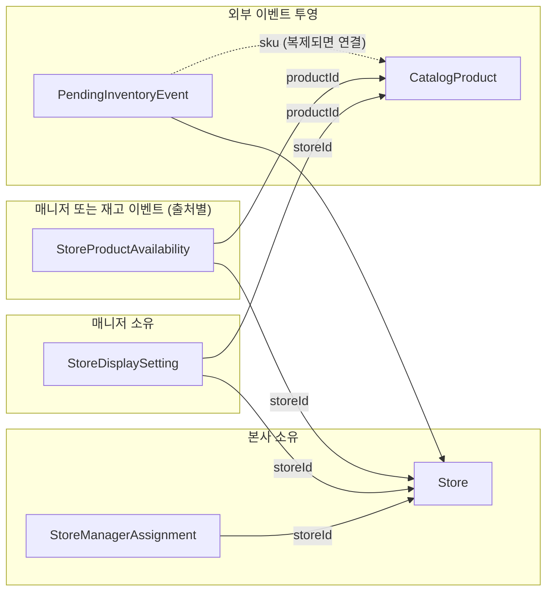
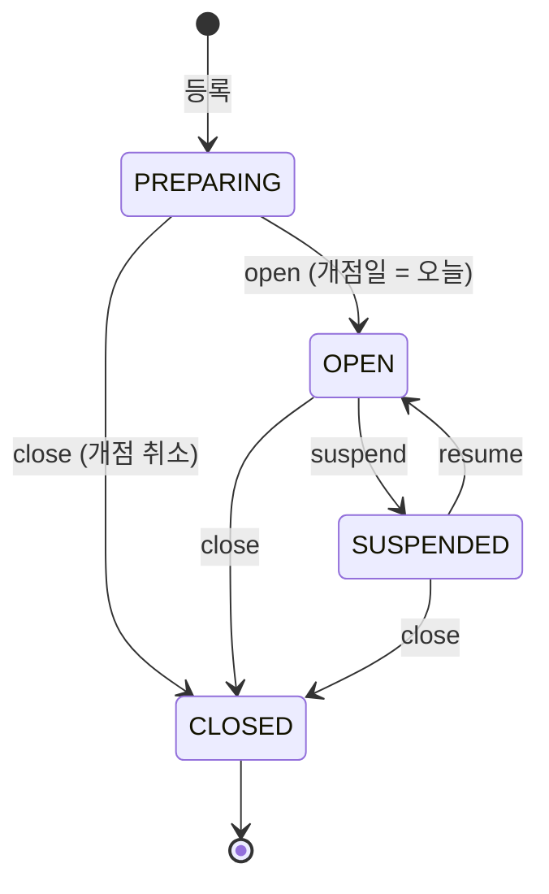

# Store 도메인 모델

> 문서별 역할과 수정 순서는 [문서 안내](README.md)를 참고한다. [요구사항](requirements.md)의 규칙을 어떤 애그리거트가 어떻게 지키는지 다룬다. 규칙 원문은 요구사항 절 번호로 참조하고, 필드·컬럼 목록은 [ERD](erd.md)와 코드를 본다.

## 경계

- **Store**: 매장, 매장 매니저, 매장별 진열 설정·판매 가능 여부·노출 판단을 소유한다([ADR-0001](adr/0001-store-owns-store-product-state.md)).
- **Catalog**: 상품 정의·상태·판매 범위의 원본이다. Store는 노출 판단에 필요한 최소한(상품 ID, SKU, 상태, 판매 범위, 재고 추적 여부)만 이벤트로 받아 `CatalogProduct`로 복제해 둔다. 이름·가격·옵션·카테고리·태그 같은 표시용 상품 정보는 복제하지 않고 필요할 때 조회한다. 손님 메뉴에서는 짧게 캐시한다(요구사항 5.1, 5.2, 7.1).
- **Auth**: 계정의 원본이다. Store는 Auth의 principal key(`principalType`, `principalId`)로 계정을 참조하고, 매장과 계정의 관계(매니저 지정)는 Store가 소유한다. Store는 토큰만 검증하고 Auth를 호출하지 않는다. 계정이 있는지는 확인하지 않고 지정 요청의 값을 믿는다(요구사항 1.3).
- **재고 서비스**: 1단계에서는 연동하지 않는다. 재고 연동(2단계)에서 매장 재고를 어디서 받을지 정한다(요구사항 8장). 이 문서에서 **(2단계)**로 표시한 것은 1단계에서 만들지 않는다.

```
Store (본 문서 대상)
├─ Store, StoreManagerAssignment
├─ StoreDisplaySetting, StoreProductAvailability
├─ CatalogProduct                                  (Catalog 상품의 로컬 복제본)
└─ PendingInventoryEvent                           (복제 전에 도착한 재고 이벤트, 2단계)

Catalog (외부)          ─ 상품 이벤트(상태 전체) ─▶ CatalogProduct
                        ◀─ 판매 범위 대상 매장 확인 ─
Auth (외부)             ─ 토큰 검증만 (Store는 Auth를 호출하지 않음)
(2단계) 재고 연동      ─ 재고 이벤트(매장 코드, SKU) ─▶ StoreProductAvailability / PendingInventoryEvent
```

## 애그리거트 지도



애그리거트끼리는 ID로만 참조한다. `productId`는 Catalog가 발급한 값이고, principal key는 Auth가 발급한 값이다. 각 애그리거트의 Repository 인터페이스는 domain이 아니라 그 모듈의 `application/port/outbound`에 둔다(헥사고날 구조, [ADR-0005](adr/0005-module-first-hexagonal-architecture.md)). 모듈 구성은 [패키지 구조](architecture/package-structure.md)에 있다.

| 애그리거트 | 소유자 | 책임 | 내부 구성 |
|---|---|---|---|
| Store | 본사 | 매장 정보, 매장 코드, 영업 상태 전이, 개점일·폐점일 | `StoreCode`(VO), `Address`(VO) |
| StoreManagerAssignment | 본사 | (매장, 계정) 한 쌍의 매니저 지정 | `PrincipalKey`(인증 라이브러리의 공유 타입) |
| CatalogProduct | Catalog 이벤트 | Catalog 상품의 상태 복제본. 순번으로 오래된 이벤트를 거르고, 삭제 사실을 남긴다 | `StoreScope`(VO) |
| StoreDisplaySetting | 매니저 | 매장별 노출·숨김, 진열 순서. 처음 바꿀 때 생성(Lazy) | `StoreDisplayOrder`(VO, 매장 전체의 진열 순서) |
| StoreProductAvailability | 매니저 (2단계에서 재고 추적 상품은 재고 이벤트) | 매장별 판매중/품절. 처음 바뀔 때 생성 | `AvailabilitySource`(OWNER, 2단계에서 INVENTORY) |
| PendingInventoryEvent **(2단계)** | 재고 이벤트 | 복제본에 아직 없는 SKU의 재고 이벤트. (매장, SKU)마다 가장 늦게 발생한 것 하나 | — |

- **매니저 지정을 Store와 나눈 이유**: 인가는 요청마다 "이 계정이 이 매장의 매니저인가"를, 매니저 화면은 "이 계정의 매장 목록"을 묻는다. 계정 쪽에서 찾는 일이 많고, 매니저를 바꿔도 매장 정보가 잠기거나 바뀌지 않아야 한다. 지킬 규칙은 "같은 쌍 중복 금지" 하나라 DB 제약으로 충분하다.
- **CatalogProduct를 애그리거트로 둔 이유**: "Catalog 상품을 Store가 알아야 하는 만큼만 비춘 것"임을 이름으로 드러낸다. 값은 이벤트로만 바뀌고 Store의 어떤 요청도 직접 바꾸지 않는다.

여러 애그리거트를 함께 보는 판단은 어느 한 애그리거트에 두지 않고 application 정책에 둔다. 정책은 I/O 없는 순수 클래스로 판단만 하고, 조회·잠금·저장은 application 서비스가 맡는다.

| 정책 | 함께 보는 것 | 판단 |
|---|---|---|
| `ProductVisibilityPolicy` | Store, CatalogProduct, StoreDisplaySetting, StoreProductAvailability | 노출 판단(요구사항 4장)의 0~4단계 |
| `StoreScopeCleanupPolicy` | CatalogProduct의 새 판매 범위, 이 상품의 진열 설정·판매 가능 여부 | 판매 범위에서 빠진 매장의 설정 중 지울 것을 고른다(요구사항 3.5) |
| `ExposureSummaryPolicy` | 상품들의 CatalogProduct, `Open`인 매장, 진열 설정·판매 가능 여부 | 상품별 판매 가능 매장 수·노출 중인 매장 수, 매장별 상세와 비노출 이유(요구사항 6장) |

## 변경 메커니즘

### 변경 경로

| 대상 | 경로 | 요청자 |
|---|---|---|
| 매장 정보(이름, 주소, 전화번호) | 즉시 반영 | 매장 관리 권한 |
| 개점 예정일 | 즉시 반영, `Preparing`에서만 | 매장 관리 권한 |
| 매장 상태 | 전용 액션 open/suspend/resume/close만. 즉시 반영만(예약 없음) | 매장 관리 권한 |
| 매니저 지정·해제 | 즉시 반영 | 매장 관리 권한 |
| 노출·숨김, 진열 순서, 수동 품절 | 즉시 반영 | 매니저, 매장 관리 권한 |
| 상품 복제본 | Catalog 상품 이벤트, 복제본 다시 맞추기 | 시스템 |
| 재고 상태(`INVENTORY`, 2단계) | 재고 이벤트 | 시스템 |

### 모델링 메커니즘

- **매장 상태 전용 액션**: 상태는 일반 정보 수정으로 바꿀 수 없다. 허용된 전이만 가능하고, 개점과 폐점은 그날을 개점일·폐점일로 기록한다(요구사항 1.2).
- **Lazy 생성**: StoreDisplaySetting은 노출·진열 순서를 처음 바꿀 때, StoreProductAvailability는 첫 수동 품절이나 첫 재고 이벤트 때 생긴다. 행이 없으면 기본값으로 판단한다(진열: 노출, 판매 가능 여부: 출처별 기본값).
- **진열 순서 일괄 변경**: 매장 전체의 순서(`StoreDisplayOrder`)로 한 번에 바꾼다. 목록의 상품은 1부터 번호를 받고, 목록에 없는 이 매장의 설정은 순서를 비운다. 같은 매장의 일괄 변경끼리는 매장 단위로 직렬화한다.
- **판매 가능 여부와 출처**: **1단계에서는 모든 상품의 출처가 `OWNER`(매니저 수동)다.** 재고 추적 상품도 같다(요구사항 3.4). 출처 구분은 2단계를 위해 남겨 둔다. 2단계에서는 출처가 CatalogProduct의 재고 추적 여부로 정해지고, `INVENTORY`는 재고 이벤트로만 바뀌며 상품 상태·판매 범위·매장 상태와 무관하게 항상 반영하고 판매 범위에서 빠져도 지우지 않는다. 전환 때 재고 추적 상품의 `OWNER` 행은 정리한다(요구사항 8.3).
- **상품 복제본 갱신**: 이벤트는 상품 상태 전체와 상품별 순번을 담는다(요구사항 7.1). `CatalogProduct.apply(snapshot)`은 순번이 복제본보다 클 때만 상태 전체를 교체하고, 반영했는지와 판매 범위가 바뀌었는지를 돌려준다. 순번이 같거나 작으면 아무것도 바꾸지 않는다. 처음 보는 상품이면 새로 만든다.
- **삭제 표시**: 삭제 이벤트를 받으면 행을 지우지 않고 삭제로 표시한다. 삭제된 복제본은 이후 어떤 이벤트로도 되살아나지 않는다. 노출 판단, 매니저 목록, 재고 이벤트 매칭은 삭제된 상품을 없는 것으로 본다. 그 상품의 매장 데이터(진열 설정, 판매 가능 여부, 보관 재고 이벤트)는 삭제를 반영할 때 함께 지운다.
- **판매 범위 정리**: 이전 판매 범위와 비교하지 않고, 이 상품의 매장 설정 중 새 판매 범위에 들지 않는 매장의 진열 설정과 `OWNER` 판매 가능 여부를 지운다(요구사항 3.5). 여러 번 해도 결과가 같다.
- **재고 이벤트 매칭 (2단계)**: 매장 코드를 Store로 매장 ID로 바꾸고(없으면 기록만), SKU로 CatalogProduct를 찾는다. 찾으면 재고 추적 상품일 때만 반영하고, 못 찾으면 PendingInventoryEvent에 보관한다(요구사항 8.2).
- **보관 재고 이벤트 (2단계)**: (매장 ID, SKU)마다 하나만 두고, 발생 시각이 더 늦은 이벤트만 덮어쓴다. 그 SKU의 상품이 처음 복제되면 보관분을 꺼내 반영하고 지운다.

## 불변식과 강제 위치

애그리거트 혼자 지킬 수 있는 규칙은 애그리거트 메서드 안에서 강제한다. 다른 애그리거트의 정보가 필요하면 application이 조회해 값으로 넘긴다. 예외 이름은 제안이며 구현 때 정한다.

### 애그리거트 내부에서 강제

| 애그리거트 | 불변식 | 위반 시 |
|---|---|---|
| Store | 상태 전이는 개점(`Preparing → Open`), 휴업(`Open → Suspended`), 재개(`Suspended → Open`), 폐점(`Closed` 외 → `Closed`)만 허용 | `InvalidStoreStatusTransitionException` |
| Store | 개점 예정일은 `Preparing`에서만 바꿀 수 있다 | `OpeningDateNotChangeableException` |
| Store | 개점하면 개점일이 그날로, 폐점하면 폐점일이 그날로 정해진다 | — (메서드가 기록) |
| Store, Address | 매장명·전화번호와 주소 항목은 비어 있지 않고 길이 제한(요구사항 1.1)을 지킨다. 상세 주소는 없거나 비어 있지 않다 | `IllegalArgumentException`(`require`). web이 요청 오류(400)로 먼저 거른다 |
| Store | 매장명은 앞뒤 공백이 없다. 이름 유일 규칙(요구사항 1.1)이 공백 차이로 무력해지지 않게 한다 | `IllegalArgumentException`(`require`). web이 공백을 제거해서 넘긴다 |
| StoreDisplayOrder | 진열 순서 목록에 같은 상품은 한 번만 들어간다 | `DuplicateDisplayOrderProductException` |
| StoreProductAvailability (2단계) | `INVENTORY` 출처의 품절 상태는 매니저가 바꿀 수 없다 | `StockStatusNotManuallyEditableException` |
| StoreProductAvailability (2단계) | `OWNER` 출처에는 재고 이벤트를 반영할 수 없다 | `InventoryEventNotApplicableException` |
| StoreProductAvailability (2단계) | 이미 반영한 것보다 오래되었거나 같은 시각의 재고 이벤트는 무시한다 | — (반영 여부를 반환) |
| CatalogProduct | 순번이 복제본보다 큰 이벤트만 반영한다 | — (반영 여부를 반환) |
| CatalogProduct | 삭제된 복제본은 되살아나지 않는다 | — (반영하지 않음) |
| CatalogProduct | 재고 추적 여부는 처음 복제한 값에서 바뀌지 않는다. 바뀐 상태가 오면 Catalog의 계약 위반이다 | `check` 위반 (반영하지 않고 오류로 기록) |
| PendingInventoryEvent (2단계) | 발생 시각이 더 늦은 이벤트만 덮어쓴다 | — (덮어썼는지를 반환) |

### application 정책에서 강제 (여러 애그리거트, I/O 없음)

| 규칙 | 정책 | 처리 방식 |
|---|---|---|
| 노출 판단 0~4단계 (요구사항 4장) | `ProductVisibilityPolicy` | Store 상태 → 상품 상태 → 판매 범위 → 진열 설정 → 숨김 순으로 보고 `StoreVisibility`를 돌려준다. 비노출이면 걸린 단계를 이유로 담는다 |
| 판매 범위에서 빠진 매장의 진열 설정과 `OWNER` 판매 가능 여부는 지우고 `INVENTORY`는 유지 (요구사항 3.5) | `StoreScopeCleanupPolicy` | 새 판매 범위와 이 상품의 설정을 받아 지울 ID를 고른다. 다른 상품의 설정이 섞이면 `require`로 거부 |
| 판매 가능 매장 수는 판매 범위 안의 `Open` 매장, 노출 중인 매장 수는 그중 노출 판단 통과 (요구사항 6장) | `ExposureSummaryPolicy` | 상품마다 `ProductVisibilityPolicy`를 매장별로 적용해 센다. 매장별 상세는 폐점하지 않은 판매 범위 안 매장을 담는다 |

### application 서비스에서 강제 (조회 필요)

| 규칙 | 필요한 정보 | 처리 방식 |
|---|---|---|
| 매장명은 폐점하지 않은 매장 사이에서 유일 (요구사항 1.1) | 같은 이름의 폐점하지 않은 매장 | application이 확인하고 거부(`StoreNameDuplicatedException`). DB 부분 UNIQUE로 이중 보장 |
| 매장 코드는 등록 시점에 시스템이 부여 (요구사항 1.1) | 전용 시퀀스 | 매장 등록 유스케이스가 `StoreCodeGenerator`로 발급  |
| 요청자가 그 매장을 다룰 수 있는가 (요구사항 2장) | 토큰의 Store 역할과 principal key, 매니저 지정 | 매장 관리 역할은 모든 매장 읽기·쓰기, 본사 조회 역할은 모든 매장 읽기, 그 밖에는 토큰의 principal key와 같은 매니저 지정이 있어야 한다. 아니면 거부 |
| 설정 변경은 폐점하지 않은 매장에서만 (요구사항 3.1) | Store 상태 | application이 Store를 불러 확인, 폐점이면 거부(`StoreClosedException`) |
| 설정 변경은 판매 범위에 든 상품만 (요구사항 3.1) | CatalogProduct | `StoreScope.covers(storeId)`로 확인. 없거나 삭제됐거나 범위 밖이면 `ProductNotFoundException`. 진열 순서 일괄 변경은 목록의 상품을 모두 확인해 하나라도 어긋나면 전체를 거부한다 |
| 판매 가능 여부의 출처 | — | 1단계에서는 항상 `OWNER`로 만든다. 2단계에서 `AvailabilitySource.of(tracksInventory)`로 바꾼다 |
| 이미 그 매장의 매니저인 계정은 다시 지정할 수 없다 (요구사항 1.3) | 기존 매니저 지정 | application이 확인하고 거부(`StoreManagerAlreadyAssignedException`). DB PK로 이중 보장 |
| 폐점한 매장에는 매니저를 새로 지정할 수 없다 (요구사항 1.3) | Store 상태 | application이 Store를 불러 확인, 폐점이면 거부(`StoreClosedException`). 해제는 폐점한 매장에서도 할 수 있다 |
| 매니저로 지정할 계정 (요구사항 1.3) | — | Store는 Auth를 호출하지 않는다. 요청의 principal key를 그대로 저장한다. 계정 종류가 `PARTNER`·`EMPLOYEE`인지만 확인한다. 계정 찾기와 본인 확인은 본사 화면이 Auth로 한다 |
| 판매 범위 대상 매장 확인 (요구사항 7.2) | Store 목록 | 넘겨받은 매장 ID 중 없거나 폐점한 매장을 돌려준다 |
| 재고 이벤트의 매장 코드·SKU 변환 (2단계, 요구사항 8장) | Store, CatalogProduct | 위 "재고 이벤트 매칭"대로 처리 |
| 매장 상품·손님 메뉴의 표시용 상품 정보 (요구사항 5.1, 5.2) | Catalog | `CatalogProductInfoPort`로 상품 기준 정보(태그 포함), 카테고리 목록(구조와 노출 순서), 유효 옵션 구성을 조회한다. 카테고리 목록은 캐시하고, 손님 메뉴는 상품 정보도 짧게 캐시한다. 판단용 상태(상품 상태, 판매 범위, 숨김, 품절)는 캐시하지 않는다. 필요한 정보를 Catalog에서 받지 못하면 요청 전체를 실패로 돌려준다 |

## 시간 처리


| 종류 | 예 | 도메인 타입 |
|---|---|---|
| 시각(순간) | Catalog 이벤트 발생 시각, (2단계) 재고 이벤트 발생 시각 | `Instant` |
| 업무 날짜 | 개점일, 개점 예정일, 폐점일 | `LocalDate` |

- 업무 날짜는 업무 기준 시간대(`Asia/Seoul`)로 해석한다. 개점·폐점의 "그날"은 그 시간대의 오늘이다.
- 도메인은 시계를 모른다. `Store.open(today)`, `Store.close(today)`처럼 오늘 날짜를 인자로 받고, application이 `Clock`과 업무 시간대로 구해 넘긴다.
- Catalog 이벤트의 순서는 발생 시각이 아니라 상품별 순번으로 판단한다. 시각은 기록용이다.

## 상태 전이

### Store



- 전이는 즉시 반영만 한다(예약 없음).
- `CLOSED`는 종료 상태다. 다시 영업하려면 새 매장으로 등록한다.
- 상태별로 누가 무엇을 볼 수 있는지는 요구사항 1.4, 메뉴 노출은 4장 0단계를 따른다.

### CatalogProduct

- 상태(`DRAFT`/`ACTIVE`/`DISCONTINUED`)와 판매 범위는 Catalog가 정하므로 Store는 전이를 검증하지 않는다. 순번이 큰 이벤트의 값으로 교체할 뿐이다.
- 삭제 표시는 종료 상태다.

### StoreDisplaySetting, StoreProductAvailability

- `visibility`(VISIBLE ⇄ HIDDEN): 매니저가 자유롭게 전환한다.
- `displayOrder`(1부터 또는 없음): 매장 전체의 진열 순서 일괄 변경으로만 바뀐다.
- `OWNER`: 처음(행 없음) 판매중. 매니저가 `ON_SALE ⇄ SOLD_OUT`으로 전환한다. 1단계에서는 모든 상품이 이 출처다.
- `INVENTORY` (2단계): 처음(행 없음) 품절. 재고 생김 → `ON_SALE`, 재고 없음 → `SOLD_OUT`. 상품 상태, 판매 범위, 매장 상태와 무관하게 계속 일어난다.

## 도메인 이벤트

Store가 다른 서비스로 내보내는 이벤트는 지금 없다. 폐점도 Catalog에 알리지 않는다(요구사항 1.2).

Store 안에서는 애그리거트가 쌓아 둔 이벤트를 저장 후 꺼내 같은 트랜잭션에서 동기로 처리한다. 핸들러가 실패하면 원래 변경도 함께 롤백된다.

| 이벤트 | 발행 시점 | 반응 |
|---|---|---|
| `CatalogProductScopeChanged` | 복제본의 판매 범위가 바뀜 (처음 복제 포함) | `StoreScopeCleanupPolicy`로 지울 설정을 골라 삭제 |
| `CatalogProductReplicated` | 상품이 처음 복제됨 | (2단계) 그 SKU의 PendingInventoryEvent를 꺼내, 재고 추적 상품이면 반영하고 지운다. 1단계에서는 구독자가 없다 |
| `CatalogProductDeleted` | 복제본이 삭제로 표시됨 | 그 상품의 진열 설정, 판매 가능 여부(2단계에서는 보관 재고 이벤트도)를 지운다 |

### 외부에서 받는 이벤트

| 이벤트 | 보낸 곳 | 반응 |
|---|---|---|
| 상품 등록됨 / 활성화됨 / 단종됨 / 판매 범위 바뀜 | Catalog | 종류와 관계없이 담긴 상태로 `CatalogProduct.apply()` |
| 상품 삭제됨 | Catalog | `CatalogProduct`를 삭제로 표시 |
| (2단계) 매장 재고 생김 / 없음 | 정해지지 않음 (요구사항 8장) | 재고 이벤트 매칭 후 `StoreProductAvailability`(`INVENTORY`)에 반영하거나 보관 |

- 같은 메시지를 다시 받아도 결과가 같다. 상품 이벤트는 순번으로, (2단계) 재고 이벤트는 발생 시각으로 거른다.
- 메시지 형식과 메시징 기술은 미정이다.

## 주요 결정

결정의 맥락, 검토한 대안, 감수한 것은 [ADR](adr/README.md)에 있다.

| 결정 | 근거 | 반영된 곳 |
|---|---|---|
| 매장 단위의 상품 상태를 Store가 소유한다 | [ADR-0001](adr/0001-store-owns-store-product-state.md) | 경계, 애그리거트 지도 |
| Catalog 상품은 판단에 필요한 최소 상태만 복제하고, 이벤트는 상태 전체를 담는다 | [ADR-0002](adr/0002-minimal-product-replica-with-full-state-events.md) | CatalogProduct, 모델링 메커니즘 |
| 매니저 지정은 직책 없이 (매장, principal key)로 두고, Store는 Auth를 호출하지 않는다 | [ADR-0003](adr/0003-store-manager-assignment-by-principal-key.md) | StoreManagerAssignment, 인가 |
| 손님 메뉴는 채널과 관계없이 로그인 없는 공개 리소스 하나로 제공한다 | [ADR-0004](adr/0004-public-customer-menu-for-all-channels.md) | `CustomerStoreView`, 표시용 정보 캐시 |
| 진열 설정과 판매 가능 여부를 나눈다. 판매 범위에서 빠질 때 매니저 값은 지우고 재고 값(2단계)은 남기는 등 수명이 다르기 때문이다 | 이 문서 | 애그리거트 지도, 모델링 메커니즘 |
| 단종·재활성화 때 매장 설정을 바꾸지 않는다. 재활성화되면 단종 전 설정을 그대로 쓴다 | 요구사항 3.5 | 상태 전이, 도메인 이벤트 |

## 타입으로 표현한 모델링 결정

| 타입 | 표현 | 이유 |
|---|---|---|
| `StoreStatus` | enum: `PREPARING` / `OPEN` / `SUSPENDED` / `CLOSED` | 전이 규칙은 Store 메서드가 지킨다 |
| `StoreCode` | value class, `ST-` 접두사 + 8자리 일련번호 | 매장 ID와 섞이지 않게 한다. 실물·사람·다른 회사 시스템을 기준으로 일하는 연동이 쓰는 키 |
| `Address` | VO: 도로명 주소, 상세 주소, 우편번호, 시·도, 시·군·구 | 지역 필터에 쓰는 값을 주소와 함께 묶는다 |
| `PrincipalKey` | 인증 라이브러리(`auth-core`)의 `PrincipalKey(type: PrincipalType, id: UUID)`를 그대로 쓴다 | 계정은 항상 (계정 종류, 계정 ID) 쌍으로 다룬다. 토큰 검증 결과와 같은 타입으로 비교한다. 매니저로는 `PARTNER`·`EMPLOYEE`만 지정할 수 있다 |
| `StoreScope` | sealed: `All` / `Limited(targetStoreIds)` | `covers(storeId)`로 포함 여부를 판단한다. `All`인데 대상 매장이 있는 모순 상태를 막는다. 빈 `Limited`는 어떤 매장도 포함하지 않는다 |
| `StoreVisibility` | sealed: `NotVisible(reason)` / `Visible(stockStatus)` | "비노출"과 "노출되지만 품절"을 Boolean 하나로는 구분할 수 없다. 비노출 이유(`STORE_NOT_OPEN` / `PRODUCT_NOT_ACTIVE` / `OUT_OF_SCOPE` / `HIDDEN`)는 노출 현황 상세(요구사항 6장)가 보여 준다 |
| `CustomerStoreView` | sealed: `Upcoming(요약, 개점 예정일)` / `Open(요약, 상세)` / `Suspended(요약)` | 손님에게 상세 정보가 나가는 경우를 `Open`으로 한정한다. 휴업 매장의 전화번호가 나가는 응답을 만들 수 없게 한다(요구사항 1.4) |
| ID 타입 | `StoreId`, `ProductId`, `Sku`, `PrincipalId` 등 value class | 서로 다른 ID를 섞어 넘기는 실수를 컴파일 단계에서 막는다 |

## 용어집

| 용어 | 코드 | 의미 |
|---|---|---|
| 매장 | `Store` | Store가 소유하는 영업 단위 |
| 매장 코드 | `StoreCode` | 외부 연동과 사람이 부르는 매장 번호 (`ST-00000123`) |
| 개점 준비 / 영업 중 / 휴업 / 폐점 | `StoreStatus.PREPARING` / `OPEN` / `SUSPENDED` / `CLOSED` | 매장의 영업 상태 |
| 개점 / 휴업 / 재개 / 폐점 | `open()` / `suspend()` / `resume()` / `close()` | 상태 전환 전용 액션 |
| 매장 매니저 | `StoreManagerAssignment` | 특정 매장의 설정을 관리할 수 있는 계정 (점주, 직영점 점장) |
| principal key | `PrincipalKey` | Auth의 계정 식별자. 계정 종류(`PrincipalType`)와 계정 ID(UUID)의 쌍 |
| 계정 종류 (파트너 / 직원) | `PrincipalType.PARTNER` / `EMPLOYEE` | realm `partner` / `internal` 계정 |
| 매장 관리 권한 / 본사 조회 권한 / 매장 매니저 역할 | Store 역할 `store:admin` / `store:viewer` / `store:manager` | 모든 매장 읽기·쓰기 / 모든 매장 읽기 / 지정된 매장만 (지정은 `StoreManagerAssignment`) |
| 상품 복제본 | `CatalogProduct` | Catalog 상품 중 노출 판단에 필요한 값만 비춘 것 |
| 순번 | `CatalogProduct.sequence` | Catalog가 상품별로 매기는 이벤트 순서. 오래된 이벤트를 거르는 기준 |
| 보관 재고 이벤트 (2단계) | `PendingInventoryEvent` | 상품이 복제되기 전에 도착한 재고 이벤트 |
| 매장 개별 설정 | `StoreDisplaySetting` | 매장별 노출·진열 순서. 없으면 기본값(노출) |
| 판매 가능 여부 | `StoreProductAvailability` | 매장별 판매중/품절. 없으면 출처별 기본값 |
| 노출 판단 | `ProductVisibilityPolicy` | 요구사항 4장의 0~4단계 판단 |
| 비노출 이유 | `StoreVisibility.NotVisible.reason` | 노출 판단에서 걸린 단계 |
| 판매 가능 매장 수 / 노출 중인 매장 수 | `ExposureSummaryPolicy` | 판매 범위 안의 `Open` 매장 수 / 그중 노출 판단을 통과한 매장 수 |
