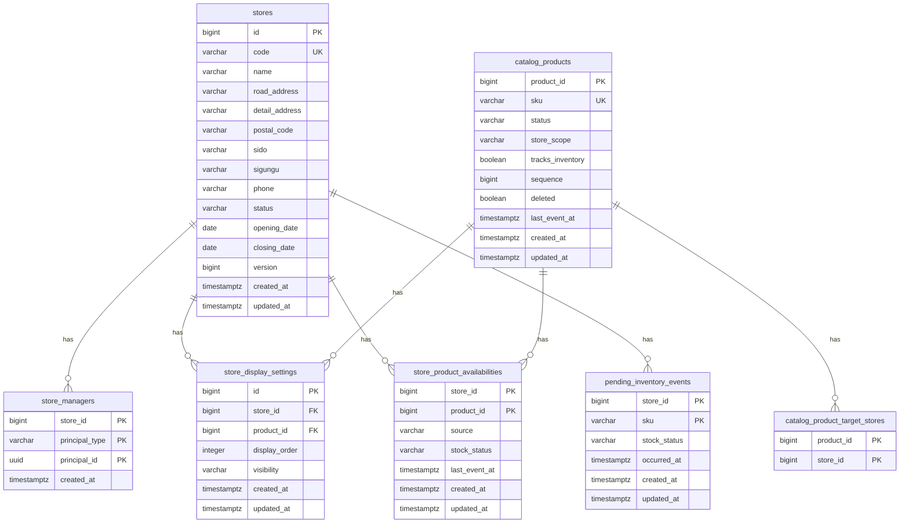

# Store ERD

> 문서별 역할과 수정 순서는 [문서 안내](README.md)를 참고한다. 애그리거트와 규칙은 [도메인 모델](domain-model.md)과 [요구사항](requirements.md)에 있다.

**DBMS**: PostgreSQL. 마이그레이션 작성 규칙은 [영속성](architecture/persistence.md)에 있다.

- **ID**: `BIGINT GENERATED ALWAYS AS IDENTITY` (DB가 생성). 매장 ID도 `BIGINT`다
- **외부 ID**: 상품 ID는 Catalog가 발급한 `BIGINT`를 그대로 쓴다. 계정은 Auth의 principal key(계정 종류 + 계정 ID `UUID`)로 참조한다
- **상태값**: `VARCHAR` + `CHECK`. PostgreSQL ENUM 타입은 쓰지 않는다. R2DBC 드라이버와 Exposed가 따로 매핑해야 하고 값을 바꾸기 번거롭기 때문이다. 값을 추가하거나 바꿀 때는 새 마이그레이션에서 `CHECK`를 교체한다
- **시각**: `TIMESTAMPTZ`. 업무 날짜(개점일, 폐점일)는 `DATE` (업무 시간대 기준)
- **감사 컬럼**: `created_at`/`updated_at`은 DB 시계(`now()`)로 채움
- **낙관적 잠금**: `stores`에만 `version BIGINT` (아래 [동시성 처리](#동시성-처리))
- **(2단계)**로 표시한 테이블·제약은 재고 연동 때 만든다. 1단계 마이그레이션에는 넣지 않는다(요구사항 8장)
- 매장과 상품 복제본이 같은 DB에 있으므로 `store_id`, `product_id`는 FK로 건다. 다만 Catalog가 보내온 판매 범위의 매장 ID(`catalog_product_target_stores.store_id`)는 FK를 걸지 않는다

---

## 다이어그램

> `pending_inventory_events`는 2단계 테이블이다. `sku`는 아직 복제되지 않은 상품을 가리키므로 `catalog_products`와 관계선이 없다. `catalog_product_target_stores.store_id`는 Catalog의 데이터라 FK를 걸지 않는다.

---

## 상태값 (`VARCHAR` + `CHECK`)

| 컬럼 | 허용 값 |
|---|---|
| `stores.status` | `PREPARING`, `OPEN`, `SUSPENDED`, `CLOSED` |
| `store_managers.principal_type` | `PARTNER`, `EMPLOYEE` (Auth의 principal type 중 매니저로 지정할 수 있는 것) |
| `catalog_products.status` | `DRAFT`, `ACTIVE`, `DISCONTINUED` |
| `catalog_products.store_scope` | `ALL`, `LIMITED` |
| `store_display_settings.visibility` | `VISIBLE`, `HIDDEN` |
| `store_product_availabilities.source` | `OWNER`, `INVENTORY`(2단계에서 씀. CHECK에는 처음부터 둔다) |
| `store_product_availabilities.stock_status`, `pending_inventory_events.stock_status` | `ON_SALE`, `SOLD_OUT` |

---

## 테이블 상세

### stores — 매장

| 컬럼 | 타입 | 제약 | 설명 |
|---|---|---|---|
| id | BIGINT | PK, identity | 매장 ID. 다른 서비스가 참조한다 |
| code | VARCHAR(16) | UNIQUE, NOT NULL | 매장 코드. 전용 시퀀스(`store_code_seq`)에서 받아 `ST-00000123` 형식으로 부여한다. 매장 ID와 시퀀스를 나눠 내부 ID가 외부에 새지 않게 한다 |
| name | VARCHAR | NOT NULL | 매장명 |
| road_address / detail_address / postal_code | VARCHAR | 도로명 주소·우편번호 NOT NULL, 상세 주소 NULL 허용 | 주소 |
| sido / sigungu | VARCHAR | NOT NULL | 지역 필터용. 주소와 함께 받는다 |
| phone | VARCHAR | NOT NULL | 매장 전화번호 |
| status | VARCHAR(20) | NOT NULL, 기본 `PREPARING`, CHECK | 전용 액션으로만 변경 |
| opening_date | DATE | NOT NULL | `PREPARING`이면 개점 예정일, 개점 후에는 실제 개점일 |
| closing_date | DATE | NULL 허용 | 폐점일 |
| version | BIGINT | NOT NULL, 기본 0 | 낙관적 잠금 |
| created_at / updated_at | TIMESTAMPTZ | NOT NULL | |
| 제약 | | `UNIQUE (name) WHERE status <> 'CLOSED'` | 매장명은 폐점하지 않은 매장 사이에서 유일 (요구사항 1.1) |
| 제약 | | `CHECK ((status = 'CLOSED') = (closing_date IS NOT NULL))` | 폐점일은 폐점한 매장에만 있다 |
| 인덱스 | | `(sido, sigungu)`, `(status)` | 본사관리자 매장 목록의 지역·상태 필터 (요구사항 1.4) |

### store_managers — 매장 매니저 지정

| 컬럼 | 타입 | 제약 | 설명 |
|---|---|---|---|
| store_id | BIGINT | PK, FK → stores.id | |
| principal_type | VARCHAR(20) | PK, CHECK | Auth의 계정 종류 |
| principal_id | UUID | PK | Auth의 계정 ID. FK 없음. 존재 여부를 확인하지 않는다(요구사항 1.3) |
| created_at | TIMESTAMPTZ | NOT NULL | 지정한 시각 (API의 `assignedAt`) |
| 인덱스 | | `(principal_type, principal_id)` | "이 계정이 매니저인 매장" 조회 (인가, 매니저의 매장 목록) |

- PK는 (매장, principal key)다. Auth의 계정 ID는 종류와 관계없이 전역에서 유일하지만, 서비스가 주체를 항상 (종류, ID) 쌍으로 다룬다는 Auth 규칙에 맞춘다.
- PK가 같은 쌍의 중복 지정을 막는다(요구사항 1.3).
- 값이 바뀌지 않는 연결이라 `updated_at`이 없다.

### catalog_products — Catalog 상품 복제본

| 컬럼 | 타입 | 제약 | 설명 |
|---|---|---|---|
| product_id | BIGINT | PK | Catalog의 상품 ID. identity가 아니다 |
| sku | VARCHAR | UNIQUE, NULL 허용 | 상품 식별. 2단계에서 재고 이벤트 매칭 키. Catalog의 과거 데이터는 비어 있을 수 있다 |
| status | VARCHAR(20) | NOT NULL, CHECK | 마지막으로 반영한 상품 상태 |
| store_scope | VARCHAR(20) | NOT NULL, CHECK | `LIMITED`면 대상 매장은 `catalog_product_target_stores` |
| tracks_inventory | BOOLEAN | NOT NULL | 처음 복제한 값에서 바뀌지 않는다 |
| sequence | BIGINT | NOT NULL | 마지막으로 반영한 이벤트의 상품별 순번. 이보다 크지 않은 이벤트는 무시한다 |
| deleted | BOOLEAN | NOT NULL, 기본 false | 삭제 표시. 한번 true가 되면 바뀌지 않는다 |
| last_event_at | TIMESTAMPTZ | NOT NULL | 마지막으로 반영한 이벤트의 발생 시각. 기록용 |
| created_at / updated_at | TIMESTAMPTZ | NOT NULL | |
| 제약 (2단계) | | `CHECK (NOT tracks_inventory OR sku IS NOT NULL)` | 재고 추적 상품에는 SKU가 있다. Catalog가 이를 보장하게 된 뒤(요구사항 8.2) 건다. 1단계에서 걸면 SKU 없는 재고 추적 상품의 이벤트 처리가 막힌다 |
| 인덱스 | | `(status) WHERE NOT deleted` | 매장 상품 목록·손님 메뉴에서 `ACTIVE` 상품 고르기 |

### catalog_product_target_stores — 복제한 판매 범위의 대상 매장

| 컬럼 | 타입 | 제약 | 설명 |
|---|---|---|---|
| product_id | BIGINT | PK, FK → catalog_products.product_id (삭제 시 CASCADE) | |
| store_id | BIGINT | PK | Catalog가 보낸 매장 ID. FK 없음 |
| 인덱스 | | `(store_id)` | "이 매장이 대상인 상품" 조회 |

- 복제본을 교체할 때 지우고 다시 넣는다.
- `store_id`에 FK를 걸지 않는 이유: Catalog의 데이터를 그대로 비추는 테이블이다. 모르는 매장 ID가 오면 FK 위반으로 이벤트 처리가 막혀 같은 메시지를 끝없이 재시도하게 된다. 지정 가능한 매장인지는 Catalog가 지정할 때 Store에 확인했다(요구사항 7.2).
- 감사 컬럼을 두지 않는다. 복제본 교체 때마다 다시 만들어지는 행이라 시각에 의미가 없다.

### store_display_settings — 매장별 진열 설정

| 컬럼 | 타입 | 제약 | 설명 |
|---|---|---|---|
| id | BIGINT | PK, identity | |
| store_id | BIGINT | FK → stores.id, NOT NULL | |
| product_id | BIGINT | FK → catalog_products.product_id, NOT NULL | |
| display_order | INTEGER | NULL 허용 | 1부터. 정하지 않았으면 NULL |
| visibility | VARCHAR(20) | NOT NULL, 기본 `VISIBLE`, CHECK | |
| created_at / updated_at | TIMESTAMPTZ | NOT NULL | 행 부재 = 기본값(노출) |
| 제약 | | `UNIQUE (store_id, product_id)` | |
| 인덱스 | | `(product_id)` | 판매 범위 정리 때 상품의 설정 조회 |

### store_product_availabilities — 매장별 판매 가능 여부

| 컬럼 | 타입 | 제약 | 설명 |
|---|---|---|---|
| store_id | BIGINT | PK, FK → stores.id | |
| product_id | BIGINT | PK, FK → catalog_products.product_id | |
| source | VARCHAR(20) | NOT NULL, CHECK | `OWNER` / `INVENTORY`. 1단계에서는 모두 `OWNER`다 |
| stock_status | VARCHAR(20) | NOT NULL, CHECK | |
| last_event_at | TIMESTAMPTZ | NULL 허용 | 마지막으로 반영한 재고 이벤트의 발생 시각(`INVENTORY`만) |
| created_at / updated_at | TIMESTAMPTZ | NOT NULL | 행 부재 = 출처별 기본값(`INVENTORY`는 품절, `OWNER`는 판매중) |
| 제약 | | `CHECK (source = 'INVENTORY' OR last_event_at IS NULL)` | `OWNER` 출처에는 재고 이벤트 시각이 없다 |
| 인덱스 | | `(product_id)` | |

### pending_inventory_events — 복제 전에 도착한 재고 이벤트 (2단계)

| 컬럼 | 타입 | 제약 | 설명 |
|---|---|---|---|
| store_id | BIGINT | PK, FK → stores.id | 매장 코드는 받을 때 매장 ID로 바꾼다. 없는 매장 코드는 보관하지 않는다 |
| sku | VARCHAR | PK | 아직 복제본에 없는 SKU |
| stock_status | VARCHAR(20) | NOT NULL, CHECK | |
| occurred_at | TIMESTAMPTZ | NOT NULL | 재고 이벤트의 발생 시각. 더 늦은 이벤트만 덮어쓴다 |
| created_at / updated_at | TIMESTAMPTZ | NOT NULL | `created_at`은 보관 기한(결정 필요)의 기준 |
| 인덱스 | | `(sku)` | 상품이 복제될 때 그 SKU의 보관분을 꺼냄 |

---

## 시퀀스

| 시퀀스 | 용도 |
|---|---|
| `store_code_seq` | 매장 코드 일련번호. 형식(`ST-00000123`)은 애플리케이션이 만든다. 롤백돼도 번호를 되돌리지 않으므로 한 번 쓴 코드가 다시 나오지 않는다 (요구사항 1.1) |

---

## 삭제 시 동작

매장과 상품 복제본은 지우지 않는다(매장은 폐점, 복제본은 삭제 표시). 행을 지우는 것은 아래뿐이다.

| 지우는 것 | 언제 |
|---|---|
| `store_managers` 행 | 본사관리자가 지정을 해제할 때 |
| `store_display_settings`, `OWNER` 출처 `store_product_availabilities` | 판매 범위에서 빠진 매장의 정리 (요구사항 3.5) |
| 그 상품의 `store_display_settings`, `store_product_availabilities` (2단계에서는 같은 SKU의 `pending_inventory_events`도) | 상품 삭제를 반영할 때 (요구사항 3.5) |
| (2단계) `pending_inventory_events` 행 | 상품이 복제되어 반영했을 때, 보관 기한이 지났을 때 |
| `catalog_product_target_stores` 행 | 복제본을 교체할 때 다시 만듦 |

FK는 대부분 삭제 제한(`NO ACTION`)으로 둔다. 매장과 복제본 행을 지우는 경로가 없으므로 CASCADE가 필요 없다. `catalog_product_target_stores`만 복제본에 딸린 값이라 CASCADE다.

---

## 동시성 처리

| 상황 | 문제 | 처리 |
|---|---|---|
| `stores` 정보 수정 | 두 관리자가 옛 화면으로 저장해 서로의 변경을 덮어씀 | 낙관적 잠금: `UPDATE … WHERE id = ? AND version = ?`, 바뀐 행이 0개면 충돌(409). 저장할 때마다 `version` + 1. 매장 정보 수정은 관리자가 화면에서 보던 값 전체를 저장하므로, 그 사이 다른 변경이 있었으면 사람이 다시 판단하게 한다 |
| `stores` 상태 전환 | 동시 요청으로 중복 전이 | 매장 행 `SELECT … FOR UPDATE` 후 전이. 저장 시 `version`도 올려 그 사이의 정보 수정 화면이 충돌로 다시 보게 한다 |
| `stores` 같은 이름 동시 등록·변경 | 확인과 저장 사이에 다른 요청이 같은 이름을 씀 | 부분 UNIQUE 위반(23505)을 `StoreNameDuplicatedException`(409)으로 바꿈 |
| `store_managers` 같은 쌍 동시 지정 | 중복 지정 | PK 위반(23505)을 `StoreManagerAlreadyAssignedException`(409)으로 바꿈 |
| `catalog_products` 이벤트 반영 | 같은 상품의 이벤트가 동시에 처리되어 오래된 쪽이 나중에 저장됨 | 상품 행 단위로 직렬화한다. 행이 있으면 `SELECT … FOR UPDATE` 후 순번을 비교해 교체, 없으면 `INSERT … ON CONFLICT (product_id) DO NOTHING` 후 다시 잠가 비교한다. 판매 범위 정리와 보관 이벤트 반영을 같은 트랜잭션에서 한다 |
| 매니저 설정 변경과 판매 범위 정리가 겹침 | 매니저가 옛 판매 범위로 확인하고 저장하는 사이 정리가 끝나, 범위 밖 매장의 설정이 남음 | 매니저 설정 변경은 상품 복제본 행을 `SELECT … FOR SHARE`로 잠근 채 판매 범위를 확인하고 저장한다. 복제본 갱신(`FOR UPDATE`)과 서로 기다리므로, 정리가 먼저면 새 범위로 거부되고 변경이 먼저면 정리에 함께 지워진다 |
| `store_display_settings` Lazy 생성 | 동시 요청 시 중복 행 | `INSERT … ON CONFLICT (store_id, product_id) DO UPDATE` |
| `store_display_settings` 노출·진열 순서 변경 | 다른 필드를 바꾸는 요청끼리 옛 값으로 덮어씀 | 바뀐 필드만 UPDATE |
| `store_display_settings` 진열 순서 일괄 변경 | 같은 매장의 일괄 변경끼리 두 순서가 섞임 | 트랜잭션 시작 직후 매장 단위 권고 잠금 `pg_advisory_xact_lock(1, storeId)`로 직렬화 |
| (2단계) `store_product_availabilities` 재고 이벤트 반영 | 중복 수신·순서 역전으로 오래된 값이 덮어씀 | `INSERT … ON CONFLICT … DO UPDATE … WHERE last_event_at IS NULL OR excluded.last_event_at > store_product_availabilities.last_event_at` |
| `store_product_availabilities` 수동 품절 첫 생성 | 동시 요청 시 중복 행 | `INSERT … ON CONFLICT (store_id, product_id) DO UPDATE` |
| (2단계) `pending_inventory_events` 보관 | 중복 수신·순서 역전 | `INSERT … ON CONFLICT (store_id, sku) DO UPDATE … WHERE excluded.occurred_at > pending_inventory_events.occurred_at` |
| (2단계) 재고 이벤트 보관과 상품 복제가 겹침 | 재고 이벤트가 복제본을 못 찾고 보관하는 사이 복제가 보관분을 이미 꺼내 가서, 보관 이벤트가 반영되지 않고 남음 | SKU 단위 권고 잠금 `pg_advisory_xact_lock(2, hashtext(sku))`로 직렬화한다. 재고 이벤트 처리는 잠금 뒤 복제본을 찾고, 상품 복제는 잠금 뒤 보관분을 꺼낸다. 해시가 겹치는 SKU끼리는 불필요하게 줄을 설 뿐 결과는 같다 |

권고 잠금의 첫 키는 용도별 네임스페이스다(1 = 매장 진열 순서, 2 = SKU 재고 매칭(2단계)). 2는 미리 예약해 두고 1단계에서는 쓰지 않는다.

---

## 감사 컬럼 정책

- 단독 엔티티 테이블: `created_at` + `updated_at`
- 연결 테이블: `created_at`만 (`store_managers`)
- `catalog_product_target_stores`는 복제본 교체 때마다 다시 만들어지므로 감사 컬럼을 두지 않는다
- 누가 매니저를 지정했는지 같은 `created_by`/`updated_by`는 계정 체계가 정해진 뒤 정한다. 넣는다면 FK 없는 principal key로 둔다

---

## 확인 필요 (미결정)

1. 재고 연동(2단계)의 테이블: 매장 재고를 어디서 받을지에 따라 `pending_inventory_events`의 필요 여부와 보관 기한, 매장 재고 수량 테이블(Store가 매장 재고를 갖게 될 경우)이 정해진다 (요구사항 8장)
2. `created_by`/`updated_by`
